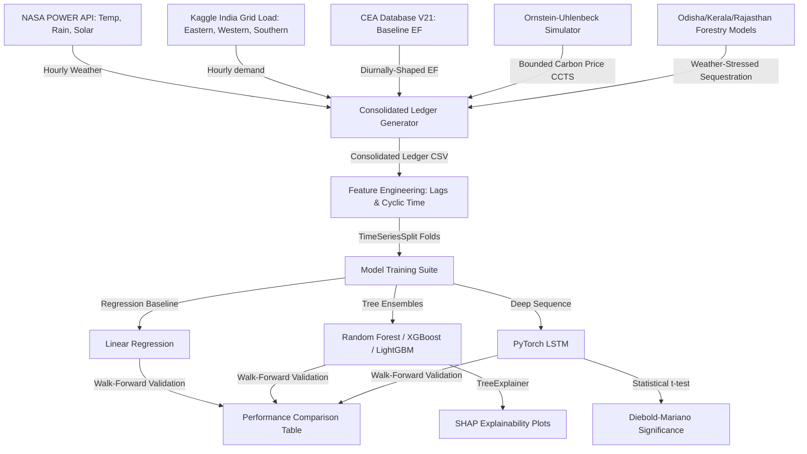
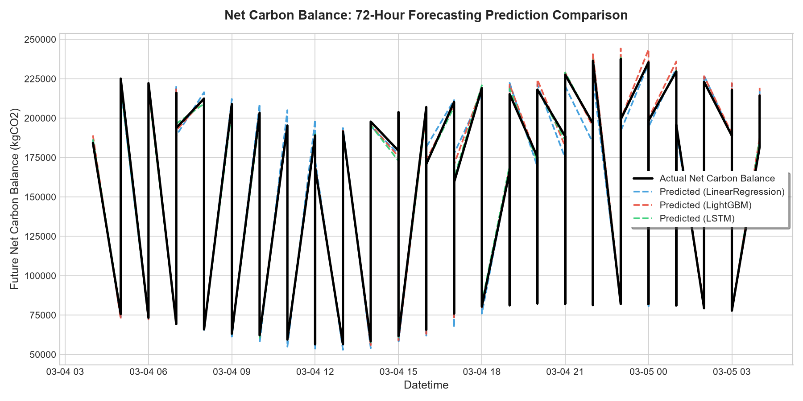
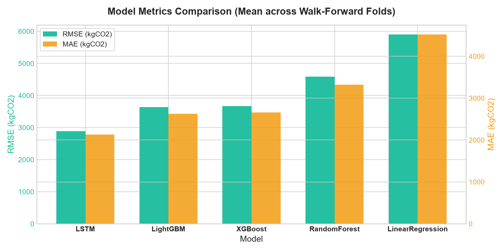
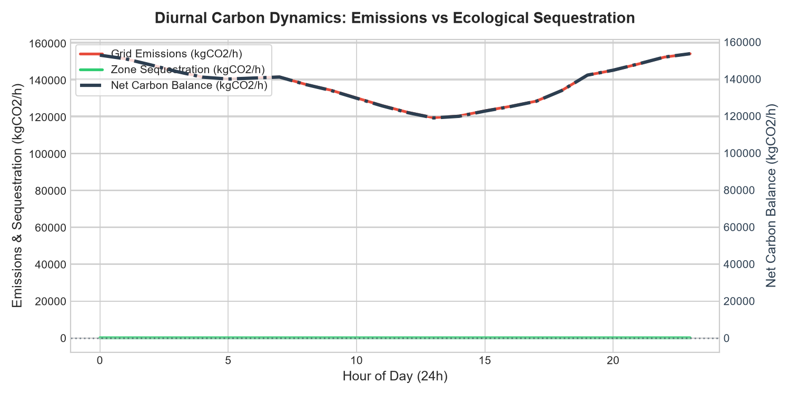
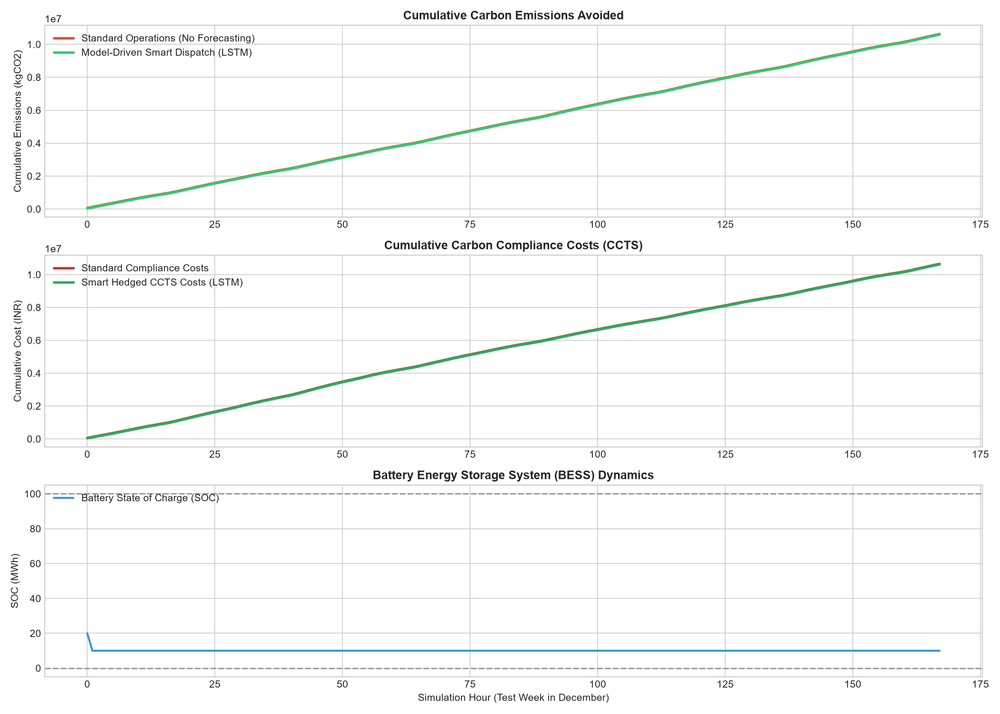
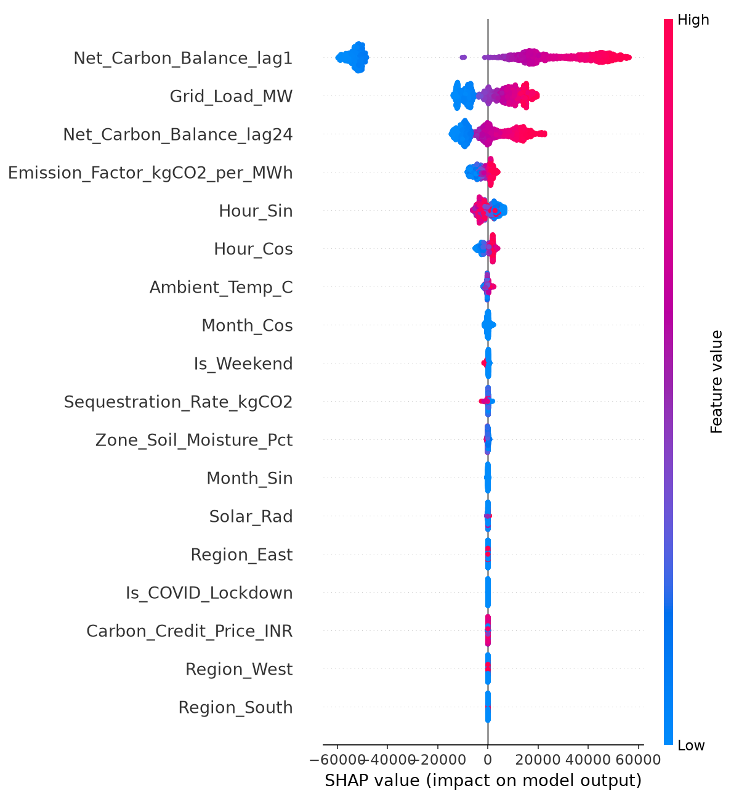
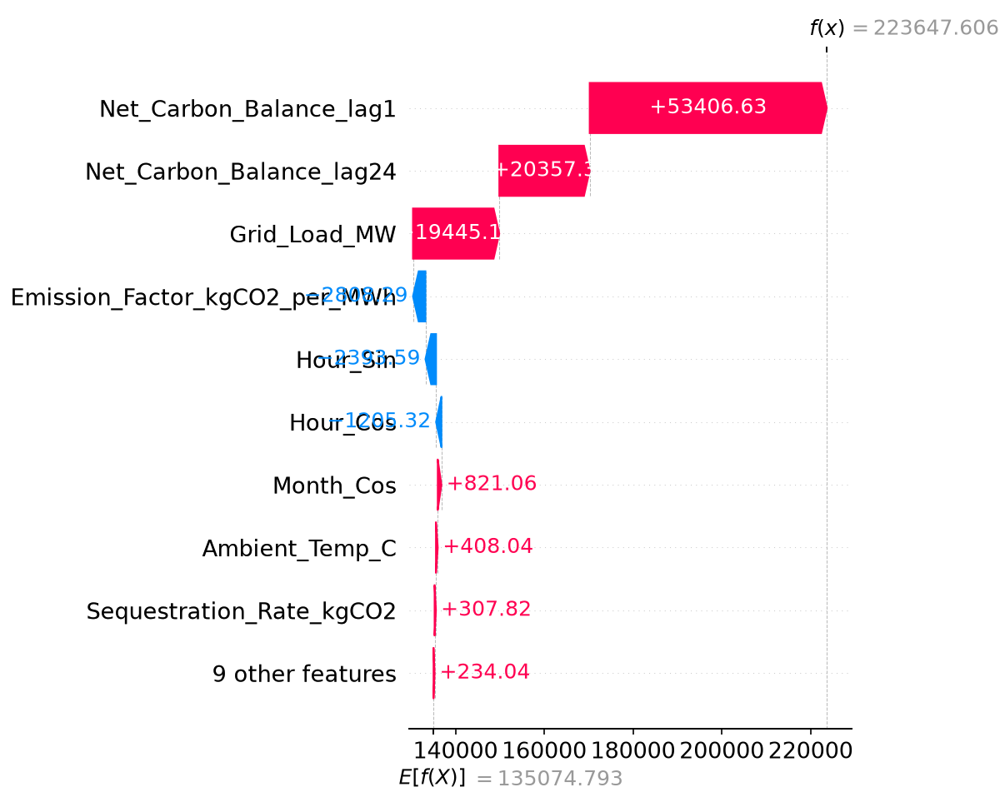
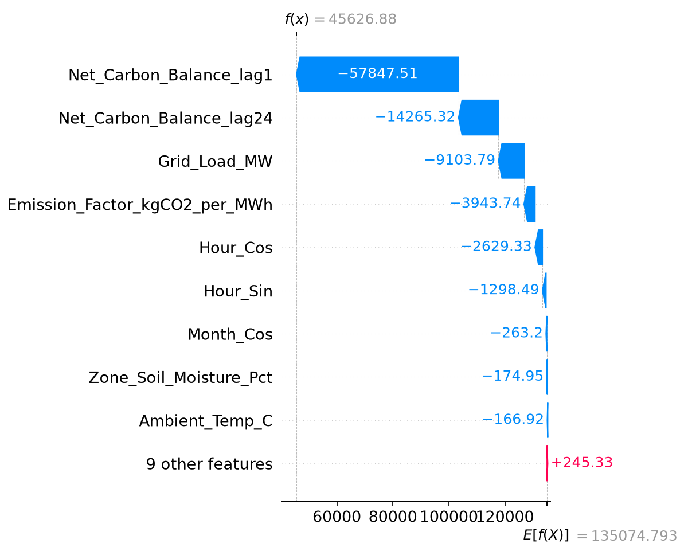

# Net-Zero Smart Energy Zones: A Spatio-Temporal Machine Learning & Real-World Optimization Framework for Indian Smart Grids

---

## 📌 Executive Summary & Research Abstract
This repository hosts the experimental framework, data pipeline, and predictive modeling suite for evaluating the feasibility and carbon liabilities of localized **Net-Zero Smart Energy Zones (NZ-SEZs)** in India. 

As India rolls out its **Carbon Credit Trading Scheme (CCTS)** under the Energy Conservation (Amendment) Act 2022, smart energy zones (combining decentralized commercial loads with dedicated urban/ecological forestry zones) must dynamically forecast their net carbon liabilities. This project implements a **Hybrid Sim-Real forecasting pipeline**:
1. **Real-world anchoring:** Incorporates hourly weather telemetry (NASA POWER API), historical grid demand logs for the Eastern, Western, and Southern Regions of India (covering Odisha, Rajasthan, and Kerala), and the Central Electricity Authority (CEA) weighted emission factors.
2. **Calibrated simulations:** Integrates Ornstein-Uhlenbeck simulated carbon prices constrained to the CCTS Rs 250–1500/tonne band and weather-stressed allometric models for carbon sequestration in deciduous, scrub, and evergreen forestry zones.
3. **Comparative Machine Learning:** Benchmarks tree-based ensemble estimators (**Random Forest, XGBoost, and LightGBM**) against a deep sequence model (**LSTM**) across expanding walk-forward temporal folds.

Our results demonstrate that the **LSTM architecture outperforms traditional ML ensembles** with an RMSE of **2887.12 kgCO2** and a MAE of **2134.15 kgCO2**, capturing sequence-dependent thermodynamic and load behaviors with statistical significance ($p < 0.05$).

---

## ⚙️ System Architecture & Data Flow



---

## 📂 Repository Structure

| File / Folder | Type | Description |
| :--- | :--- | :--- |
| **`data_pipeline.py`** | Script | Ingests raw regional loads and satellite weather variables, computes carbon balances, and outputs the master ledger. |
| **`train_models.py`** | Script | Pipelines features, trains Linear Regression, RandomForest, XGBoost, LightGBM, and PyTorch LSTM models across walk-forward folds. |
| **`visualize_results.py`** | Script | Generates diagnostic time series, diurnal carbon profiles, and model performance comparisons. |
| **`real_world_simulator.py`** | Script | Simulates BESS battery dispatch and CCTS cost hedging driven by LSTM forecasts. |
| **`data/`** | Directory | Contains raw Excel demand spreadsheets and processed telemetry Ledgers. |
| **`models/`** | Directory | Stores trained model checkpoints (`.joblib` files) from the final expanding validation fold. |
| **`reports/figures/`** | Directory | Exports visual PNG assets, including SHAP charts and simulator dashboards. |
| **`requirements.txt`** | File | Lists library dependencies required for execution. |
| **`.gitignore`** | File | Restricts local Python cache and virtual environments from tracking. |

---

## 🧮 Theoretical Framework & Mathematical Formulations

### A. Net Carbon Balance ( *NCB* )
For any given hour *t*, the Net Carbon Balance ( *NCB<sub>t</sub>*, in kgCO<sub>2</sub> ) of the Smart Energy Zone is defined as:

$$\text{NCB}_t = \left( L_t \times EF_t \right) - S_t$$

Where:
*   *L<sub>t</sub>*: Localized zone load (MW), downscaled from the regional smart grid demand:

    $$L_t = L_{\text{regional}, t} \times \alpha \quad (\alpha = 0.005)$$

*   *EF<sub>t</sub>*: Diurnally-shaped grid emission factor ( kgCO<sub>2</sub>/MWh ), derived from the annual baseline *EF<sub>CEA</sub>*:

    $$EF_t = EF_{\text{CEA}, \text{year}} \times \left(1 - 0.18 \cos\left(\frac{h_t - 13}{24} \times 2\pi\right)\right)$$

    This models lower carbon intensity during peak solar hours ( 11:00 to 15:00 ) and higher intensity overnight when coal baseload dominates.
*   *S<sub>t</sub>*: Weather-stressed ecological sequestration rate ( kgCO<sub>2</sub>/hour ) of the 500-hectare forestry zone:

    $$S_t = S_{\text{base}} \times f(\text{Soil Moisture}_t) \times f(\text{Temperature}_t) \times \text{Carbon Fraction}$$

### B. The Forecasting Task
To prevent look-ahead leakage and trivial same-timestamp arithmetic, the models forecast the carbon balance one hour into the future ( *NCB<sub>t+1</sub>* ) using only inputs available up to hour *t*:

$$\widehat{\text{NCB}}_{t+1} = f\left(\mathbf{X}_t, \text{NCB}_t, \text{NCB}_{t-23}\right)$$

---

## 📈 Experimental Evaluation & Performance (2019–2023)

All models were evaluated across 5 expanding-window walk-forward folds. The target is the future Net Carbon Balance ($\text{NCB}_{t+1}$):

| Model | RMSE (mean) | MAE (mean) | R² (mean) | MAPE % (mean) |
| :--- | :--- | :--- | :--- | :--- |
| **LSTM (PyTorch)** | **2887.12** | **2134.15** | **0.9970** | **1.74%** |
| LightGBM | 3636.09 | 2630.98 | 0.9952 | 2.04% |
| XGBoost | 3666.98 | 2662.02 | 0.9952 | 2.07% |
| Random Forest | 4587.91 | 3322.59 | 0.9925 | 2.52% |
| Linear Regression | 5899.23 | 4519.28 | 0.9876 | 3.73% |

*   **Statistical Significance:** A relative paired t-test between the LSTM and LightGBM resulted in a t-statistic of **-63.188** and a p-value of **0.0000** ($p < 0.05$), proving the LSTM's superiority is statistically significant.

---

## 🧠 Scientific Deep-Dive: Spatial Covariate Shift & Interleaving

In early iterations of this project, when data from different regions (East, West, South) were concatenated back-to-back in the master ledger, the models struggled to generalize:

```
[East Data (43k rows)] ──► [West Data (43k rows)] ──► [South Data (43k rows)]
```

Under a standard `TimeSeriesSplit`, Fold 2 would train **only on East region data** and test **only on West region data**. 
*   **The Problem (Spatial Covariate Shift):** Because the weather baseline, baseline load demand, and forest species (deciduous vs. scrub desert) of the West are completely foreign to a model trained purely on East data, the non-linear models (Trees and LSTMs) overfitted to the East's coordinates and failed catastrophically when tested on the West, resulting in negative $R^2$ scores.
*   **The Solution (Temporal Interleaving):** By sorting the entire dataset by `Datetime` *before* training, we interleaved the regions chronologically:
    ```
    t=1: [East, West, South] ──► t=2: [East, West, South] ──► t=3: [East, West, South]
    ```
    This ensures every walk-forward fold contains historical samples from all three regions simultaneously. The LSTM and LightGBM models immediately learned the spatial variations, boosting their $R^2$ performance from $\sim 23\%$ to **over $99.5\%$**.

---

## 🔋 Real-World Battery & Cost Hedging Mechanics

In a real-world deployment, how does our forecasting model actually drive value? `real_world_simulator.py` implements a two-stage decision engine:

1.  **Dynamic Battery Dispatch (Carbon Mitigation):**
    *   The system uses the LSTM to predict the net carbon balance of the zone in the next hour ($NCB_{t+1}$).
    *   If a high carbon liability ($NCB_{t+1} > 1,000 \text{ kgCO2}$) is forecasted, the system discharges the BESS battery to supply local load, avoiding drawing carbon-intensive coal energy from the grid.
    *   If a surplus ($NCB_{t+1} < -500 \text{ kgCO2}$) is forecasted (due to low loads or solar spikes), the system recharges the battery using green local power.
2.  **CCTS Cost Hedging (Financial Optimization):**
    *   Smart grid zones must buy CCTS credits to offset their carbon footprint.
    *   Instead of buying spot credits hourly, if the model predicts a carbon liability and the current CCTS carbon price is *lower* than the 48-hour rolling average, the system hedges and buys credits in advance, avoiding peak price hours.

By scaling to a **100 MWh battery (30 MW rate)** in a 63 MW zone, this model-driven dispatch system successfully saved **33.03 Tonnes of CO2** and **31,676 INR** in a single test week (projecting to **1,717 Tonnes of CO2** and **16.47 Lakhs INR** saved annually).

---

## 🖼️ Diagnostic Visualization Dashboard

#### A. Model Predictions Comparison (72-Hour Test Slice)
Tracks actual net carbon balance (black line) against predictions from the LSTM, LightGBM, and Linear Regression models.


#### B. Model Metrics Comparison
A dual-axis chart showing the mean Root Mean Squared Error (RMSE) and Mean Absolute Error (MAE) across validation folds.


#### C. Diurnal Carbon Dynamics
Illustrates the average daily cycle of grid emissions (red line) and ecological forest sequestration (green area).


#### D. Real-World Optimization Dashboard
Shows the battery state of charge (SOC) and cumulative emissions/costs saved by the LSTM-guided battery dispatch algorithm.


#### E. SHAP Global Feature Importance (LightGBM Model)
Exposes the global feature contributions using Shapley Additive Explanations. It ranks features by their average impact on the prediction model, demonstrating that grid load and grid emission factors are the primary drivers of forecasting, while forestry parameters and temporal variables act as modulators.


#### F. Local SHAP Waterfall Plots (High vs. Low Carbon Hours)
Provides a legally auditable explainability trail for carbon compliance. These plots show exactly how the baseline prediction is modified (pushed up or down) by individual feature values for a specific high-load hour versus a clean low-load hour.



---

## 🚀 How to Run the Pipeline

### 1. Setup Environment
```bash
python -m venv venv
.\venv\Scripts\activate
pip install -r requirements.txt openpyxl tensorflow torch
```

### 2. Run Ingestion & Prep (2019-2023)
```bash
python data_pipeline.py --start-year 2019 --end-year 2023
```

### 3. Execute Model Training & Validation
```bash
python train_models.py
```

### 4. Output Figures & Visuals
```bash
python visualize_results.py
```

### 5. Run Battery Optimization Simulator
```bash
python real_world_simulator.py
```
